# Parking database design

Migration: `src/main/resources/db/migration/V9__vehicles_and_parking.sql`. It reuses the existing `societies`,
`flats`, `users`, `visitors`, `society_gates`, `society_counters` and `audit_logs` tables and adds 15 tables.
Hibernate validates every new entity against this schema at start-up (`ddl-auto=validate`).

## 1. Tables

| Table | Purpose | Prompt's suggested table |
| --- | --- | --- |
| `society_parking_settings` | 1:1 per society: feature switches, limits, entry/exit policy, payment methods, vehicle restrictions, rules | `society_parking_settings` |
| `vehicles` | Registry of resident, society, staff, service, emergency, paid and visitor vehicles | `vehicles` |
| `parking_areas` | Basement 1, Visitor parking… with usage and allowed vehicle types | `parking_areas` |
| `parking_slots` | Physical slots: vehicle type, intended usage, operational status | `parking_slots` |
| `parking_allocations` | Who may use a slot for which period (permanent, temporary, visitor, paid, society) | `parking_allocations` |
| `parking_requests` | Resident requests **and** visitor parking requests (`request_type = VISITOR_SLOT`) | `parking_requests` + `parking_visitor_requests` (consolidated, see §3) |
| `parking_permits` | The authorisation the gate checks; numbered (`GREENWOOD-RES-1001`) | `parking_permits` |
| `parking_verifications` | Single-use, 5-minute result of a guard's vehicle check, required for entry | new |
| `parking_sessions` | One parked stay: entry → exit, slot, charges, payment status, rate snapshot | `parking_sessions` |
| `parking_movements` | Append-only gate events (entry, override entry, exit, overstay, payment, cancel) | `parking_movements` |
| `parking_rate_plans` | Pricing per society / area / vehicle type / audience / billing unit, with tax and caps | `parking_rate_plans` |
| `parking_quotes` | Server-computed charge (estimate, session exit charge, permit fee), referenced by payments | new |
| `parking_payments` | Payment records (session or permit) with status lifecycle | `parking_payments` |
| `parking_payment_events` | Append-only payment history (created, confirmed, failed, refunded, waived) | `parking_payment_events` |
| `parking_receipts` | Immutable receipts, numbered per society | `parking_receipts` |

## 2. Entity relationship diagram

```mermaid
erDiagram
    SOCIETIES ||--|| SOCIETY_PARKING_SETTINGS : configures
    SOCIETIES ||--o{ VEHICLES : ""
    FLATS |o--o{ VEHICLES : "resident vehicles"
    USERS |o--o{ VEHICLES : "owner / reviewer"
    SOCIETIES ||--o{ PARKING_AREAS : ""
    PARKING_AREAS ||--o{ PARKING_SLOTS : ""
    PARKING_AREAS |o--o{ PARKING_RATE_PLANS : "area-specific rate"
    PARKING_SLOTS ||--o{ PARKING_ALLOCATIONS : "no overlapping periods"
    FLATS |o--o{ PARKING_ALLOCATIONS : ""
    VEHICLES |o--o{ PARKING_ALLOCATIONS : ""
    FLATS ||--o{ PARKING_REQUESTS : "requested for"
    VISITORS |o--o{ PARKING_REQUESTS : "visitor parking"
    PARKING_REQUESTS |o--o| PARKING_ALLOCATIONS : "approval creates"
    PARKING_REQUESTS |o--o| PARKING_PERMITS : "approval issues"
    PARKING_ALLOCATIONS |o--o{ PARKING_PERMITS : ""
    VEHICLES |o--o{ PARKING_PERMITS : ""
    SOCIETY_GATES ||--o{ PARKING_VERIFICATIONS : "checked at"
    PARKING_VERIFICATIONS |o--o| PARKING_SESSIONS : "single use"
    PARKING_SLOTS |o--o{ PARKING_SESSIONS : "one active at a time"
    VEHICLES |o--o{ PARKING_SESSIONS : ""
    VISITORS |o--o{ PARKING_SESSIONS : ""
    PARKING_PERMITS |o--o{ PARKING_SESSIONS : ""
    PARKING_RATE_PLANS |o--o{ PARKING_SESSIONS : "snapshot at entry"
    PARKING_SESSIONS ||--o{ PARKING_MOVEMENTS : "immutable"
    PARKING_RATE_PLANS ||--o{ PARKING_QUOTES : ""
    PARKING_SESSIONS |o--o{ PARKING_QUOTES : ""
    PARKING_SESSIONS |o--o{ PARKING_PAYMENTS : ""
    PARKING_PERMITS |o--o{ PARKING_PAYMENTS : ""
    PARKING_QUOTES |o--o| PARKING_PAYMENTS : "settles"
    PARKING_PAYMENTS ||--o{ PARKING_PAYMENT_EVENTS : "immutable"
    PARKING_PAYMENTS ||--o| PARKING_RECEIPTS : "immutable"

    VEHICLES {
        uuid id PK
        uuid society_id FK
        varchar registration_number "normalised, unique per society while active"
        varchar vehicle_type "CAR BIKE SCOOTER OTHER"
        varchar category "RESIDENT VISITOR PAID SOCIETY STAFF SERVICE EMERGENCY"
        uuid flat_id FK "required for RESIDENT"
        varchar registration_status "NOT_SUBMITTED PENDING APPROVED REJECTED SUSPENDED"
        boolean active
    }
    PARKING_SLOTS {
        uuid id PK
        uuid area_id FK
        varchar slot_number "unique per area"
        varchar vehicle_type
        varchar usage_type
        varchar operational_status "ACTIVE OUT_OF_SERVICE"
    }
    PARKING_ALLOCATIONS {
        uuid id PK
        uuid slot_id FK
        varchar allocation_type
        varchar status
        timestamptz valid_from
        timestamptz valid_until "null = open-ended"
    }
    PARKING_SESSIONS {
        uuid id PK
        varchar vehicle_number
        varchar category
        varchar status "ACTIVE COMPLETED CANCELLED"
        timestamptz entry_at
        timestamptz exit_at
        numeric final_amount
        numeric paid_amount
        varchar payment_status
        text rate_snapshot
    }
    PARKING_PAYMENTS {
        uuid id PK
        varchar purpose "SESSION PERMIT"
        numeric amount "12,2"
        varchar currency "ISO 4217"
        varchar method
        varchar status "PENDING PAID FAILED REFUNDED WAIVED"
    }
```

## 3. Design decisions

| Decision | Reason |
| --- | --- |
| **Visitor parking requests live in `parking_requests`** (`request_type = VISITOR_SLOT`, visitor columns, `visitor_id` FK) | The Flutter app models one `ParkingRequest` with an optional `visitor` block and lists both kinds through the same endpoint. One table keeps one reference sequence, one approval code path and one duplicate rule |
| `parking_verifications` added | The Flutter contract requires entry to quote a fresh verification id from the same guard; storing it makes it single-use, expiring and auditable |
| `parking_quotes` added | Payments must reference a server-computed amount; the quote id ties a payment to that computation and is unique per live payment |
| Slot holds **one** `vehicle_type`; two-wheelers share | `BIKE` and `SCOOTER` slots accept both two-wheeler types; `CAR` and `OTHER` slots accept only their type. The API exposes the accepted set as `vehicleTypes` |
| Session `OVERSTAY` is derived | Stored status stays `ACTIVE`; the API reports `OVERSTAY` when `now > valid_until + grace`. The overstay job only records the notification time and an `OVERSTAY` movement |
| `paid_amount` cached on the session | Updated in the same transaction as every payment status change; avoids summing payments on every gate screen |
| `rate_snapshot` (JSON text) | Historical pricing for completed sessions; editing a rate never changes an existing session's charge |
| Reference numbers from `society_counters` | Atomic `INSERT … ON CONFLICT DO UPDATE … RETURNING`, the same mechanism as complaint tickets: `PR-1001`, `<CODE>-RES-1001`, `<CODE>-RC-2026-1001` |
| Area `vehicle_types`, settings lists as newline text | Same `TextListConverter` convention as `society_settings.visit_purposes` |

## 4. Integrity rules enforced by PostgreSQL

| Invariant | Mechanism |
| --- | --- |
| Records never point to another society's flat, slot, area, vehicle, visitor, gate, permit, request, rate or session | Composite FKs `(x_id, society_id) → x (id, society_id)` (new `UNIQUE (id, society_id)` on every parking table and on `visitors`) |
| Unique slot number within an area | `uq_parking_slots_number (area_id, slot_number)` |
| One active vehicle per registration number per society | partial unique `ux_vehicles_active_number … WHERE active` |
| A resident vehicle belongs to a flat | `ck_vehicles_resident_flat` |
| **No overlapping live allocations of a slot** | `ex_parking_allocations_overlap EXCLUDE USING gist (slot_id WITH =, tstzrange(valid_from, valid_until) WITH &&) WHERE status IN (ACTIVE, PENDING, SUSPENDED)` |
| No duplicate pending request (flat, type, vehicle number) | partial unique `ux_parking_requests_pending` |
| **One active session per vehicle per society** | partial unique `ux_parking_sessions_active_vehicle … WHERE status = 'ACTIVE'` |
| **One active session per slot** | partial unique `ux_parking_sessions_active_slot` |
| A verification is used by at most one session | `uq_parking_sessions_verification` |
| Exit never before entry; completed sessions have an exit time | `ck_parking_sessions_exit_order`, `ck_parking_sessions_completed` |
| Override entries carry a reason | `ck_parking_sessions_override` |
| Money is non-negative, two decimals, ISO currency | `numeric(12,2)` + `CHECK (>= 0)`, `CHECK (currency ~ '^[A-Z]{3}$')` |
| A payment targets a session or a permit; settled payments have method and time; waivers use the `WAIVER` method | `ck_parking_payments_*` |
| A quote settles at most one live payment | partial unique `ux_parking_payments_quote` |
| Status values | `CHECK (... IN (...))` on every status / type column |
| Movement, payment-event and receipt rows are immutable | `BEFORE UPDATE` triggers using the existing `forbid_row_update()` |
| Registration numbers are normalised | `CHECK (registration_number ~ '^[A-Z0-9]{4,13}$')` (also on requests, permits, sessions) |

Concurrency, in addition to the constraints:

* Allocation and auto-assignment lock the candidate slot row (`SELECT … FOR UPDATE`) before the overlap check, so
  concurrent requests for the same slot are serialised and the loser gets `409 ALLOCATION_CONFLICT` /
  `PARKING_UNAVAILABLE` instead of a constraint error.
* Entry takes a transaction-scoped advisory lock on `(society, vehicle number)` before checking for an active
  session; the partial unique index is the backstop.
* Session close, payment confirmation, request decisions and vehicle reviews lock the row (`PESSIMISTIC_WRITE`) and
  every mutable aggregate carries `@Version`.

## 5. Indexes for the main queries

| Query | Index |
| --- | --- |
| Vehicle by exact number (gate) | `ux_vehicles_active_number` |
| Vehicle number prefix search | `ix_vehicles_number_prefix (society_id, registration_number varchar_pattern_ops)`; contains-search scans one society's vehicles only |
| Flat's vehicles / allocations / permits / requests / sessions / payments | `ix_*_flat` |
| Permits for a number | `ix_parking_permits_vehicle_number` (partial: live permits) |
| Usable visitor request for a number | `ix_parking_requests_usable` (partial: approved, not consumed) |
| Overstay and expiry jobs | `ix_parking_sessions_overstay`, `ix_parking_permits_expiry` (partial) |
| Revenue by day | `ix_parking_payments_paid (society_id, paid_at) WHERE status = 'PAID'` |

## 6. Soft deletion and retention

Nothing is hard-deleted by the API:

* Vehicles: `active = false` (history and sessions keep pointing at them; the number becomes registrable again).
* Areas: `status = INACTIVE`; slots: `OUT_OF_SERVICE`.
* Allocations: `EXPIRED` / `REVOKED` with `ended_at`, `ended_by`, `end_reason`.
* Permits: `EXPIRED` / `REVOKED` / `SUSPENDED`.
* Payments: status changes only (`REFUNDED`, `FAILED`), each recorded as an immutable payment event.

Retention (`ParkingJobs`): visitor name/mobile on visitor parking requests are removed after the society's
`visitor_retention_days`, like visitor records. Verifications older than 7 days and unused estimate quotes older than
7 days are deleted (they are transient technical records; the movement, session, payment and audit tables keep the
history).

## 7. Migration notes

* **Additive only.** V9 creates the 15 tables, their indexes and three immutability triggers, and seeds 13 permissions
  and their role grants.
* **Existing tables touched (no data change):**
  * `visitors`: `ADD CONSTRAINT uq_visitors_id_society UNIQUE (id, society_id)` — always satisfiable because `id` is
    the primary key; builds one index.
  * `guard_permissions`: the generated CHECK constraint from V3 is dropped and replaced by
    `ck_guard_permissions_permission`, which allows the same three values plus `VEHICLE_ENTRY`. No row is changed;
    existing guards do not receive the new toggle.
* **Extension:** `CREATE EXTENSION IF NOT EXISTS btree_gist`. Trusted since PostgreSQL 13, so the database owner can
  create it without superuser rights. If a managed database refuses it, run the statement once as an administrator
  before deploying.
* **Rollback:** V9 can be reverted manually by dropping the 15 new tables, the new constraint on `visitors` and the
  new permissions; Flyway is not configured for automatic undo (same as V1–V8).
* **Upgrade path test:** `ParkingMigrationIT` migrates a database to V8, inserts Phase 1 data, then migrates to V9
  and checks that the old rows are intact and the new constraints work.
* **Settings rows:** existing societies get `society_parking_settings` lazily (defaults) on first read; the migration
  does not insert rows into existing societies.
