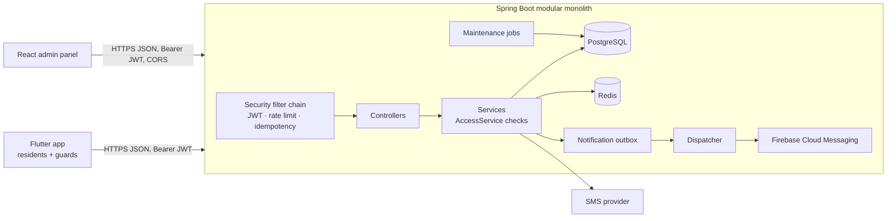
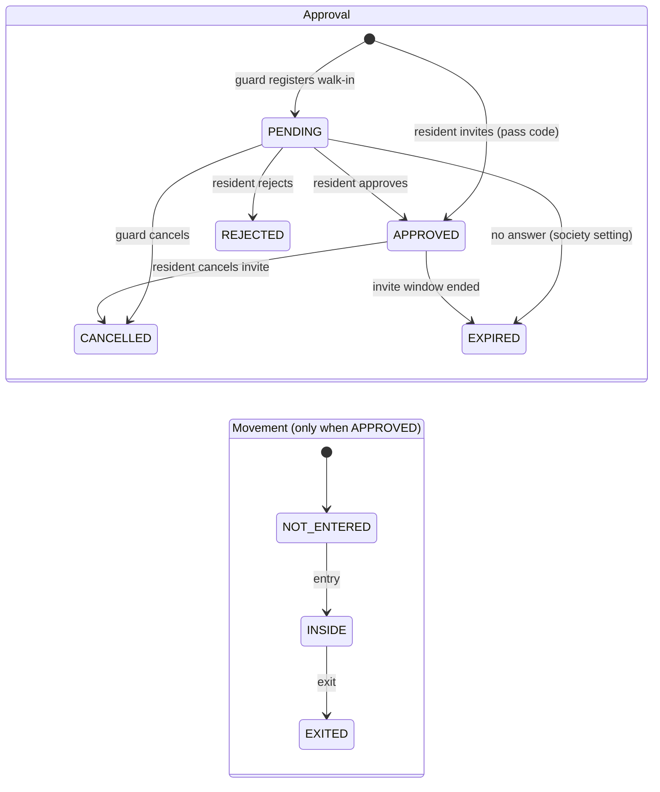
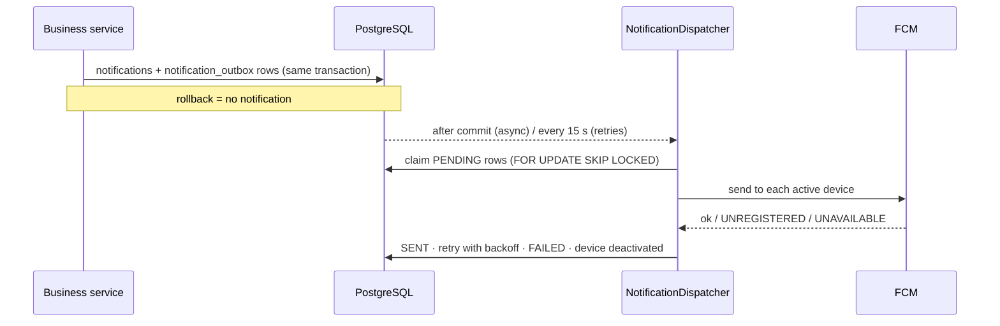

# Architecture

## Overview

* **Modular monolith**: one deployable, one package per feature (`auth`, `society`, `flats`, `residents`, `guards`,
  `visitors`, `deliveries`, `domesticstaff`, `complaints`, `notices`, `notifications`, `reports`, `audit`, `activity`,
  `files`). Each module owns its entities, repositories, services, DTOs and controller.
* **Thin controllers**: validation (Bean Validation), mapping of HTTP to service calls, OpenAPI annotations.
  Services hold business rules and transactions. Entities are never returned; every response is a DTO record.
* **PostgreSQL** is the system of record (Flyway migrations, Hibernate `ddl-auto=validate`).
  **Redis** holds short-lived state only: OTP challenges, rate-limit counters, idempotency keys.

## Request pipeline

1. `BearerTokenAuthenticationFilter` verifies the HS256 JWT (signature, issuer, audience, expiry, `sid` claim).
2. `JwtAuthenticationConverter` checks on **every request** that the user is still ACTIVE and the login session is not
   revoked, and loads current roles as `ROLE_*` authorities (roles are not baked into tokens, so deactivation and
   membership changes apply immediately).
3. `RateLimitFilter` — per user (or IP) requests per minute, Redis fixed window, fail-open.
4. `IdempotencyFilter` — optional `Idempotency-Key` on POST: the first 2xx response is stored for 24 h and replayed.
5. Controller `@PreAuthorize` role check (coarse), then the service's **scoped permission check** (fine).
6. `GlobalExceptionHandler` turns every failure into `{ success:false, code, message, errors[], timestamp, path }`.

## Authentication

* `POST /auth/request-otp` → 6-digit OTP, stored in Redis as an **HMAC** (`otp:req:{requestId}`), 5 min TTL.
  Limits: 30 s resend cooldown, 5 requests/hour per mobile, 30/hour per IP, 5 verification attempts per code
  (counted *before* comparison). Only existing, active users with an active/pending membership can request a code.
* `POST /auth/verify-otp` → access token (15 min) + opaque refresh token (30 days, 256-bit random). Only the
  SHA-256 of the refresh token is stored (`refresh_sessions`).
* `POST /auth/refresh` rotates the refresh token. Presenting an already-rotated token revokes the whole session
  (`REFRESH_TOKEN_REUSED`), which also invalidates its access tokens on their next use.
* SMS: `SmsSender` abstraction — `mock` (dev only, with a fixed OTP), `twilio`, `none`.

## Authorization model

| Layer | Mechanism |
| --- | --- |
| Roles | `SUPER_ADMIN` (platform, `user_roles`); `SOCIETY_ADMIN`, `RESIDENT`, `GUARD` (per society, `society_memberships`) |
| Permissions | `role_permissions` table (seeded by V8, cached in `RolePermissionRegistry`); checked with a society scope: `access.require(societyId, Permission.X)` |
| Flat scope | Residents act only on their ACTIVE flat memberships (`access.requireResidentFlat(flatId, ...)`) |
| Gate scope | Guards: active guard of the society + role permission + per-guard toggle (`VISITOR_ENTRY`, `DELIVERY_ENTRY`, `STAFF_ATTENDANCE`) + on duty + assigned to an active gate (`access.requireOnDutyGuard(...)`) |
| Tenant isolation | Every society-owned row has `society_id`. Records loaded by id are checked with `access.ensureInScope(...)`: outside the caller's societies they are reported as **404** (existence is not revealed); inside the society but not permitted → **403** |
| Society context | Derived from memberships; multi-society users may send `X-Society-Id` (validated) |
| Inactive society | Memberships of an INACTIVE society are ignored → members lose access; super admins keep it |

Database-level tenant integrity: composite foreign keys such as `visitors (flat_id, society_id) → flats (id, society_id)`
make it impossible to attach a flat or gate of another society, even through a bug.

## Visitor lifecycle

Approval and gate movement are separate state machines; the Flutter app receives a derived `status`.

| approvalStatus | movementStatus | source | Flutter `status` |
| --- | --- | --- | --- |
| any | INSIDE | any | `CHECKED_IN` |
| any | EXITED | any | `CHECKED_OUT` |
| APPROVED | NOT_ENTERED | INVITATION | `PRE_APPROVED` |
| X | NOT_ENTERED | any | X (`PENDING`, `APPROVED`, `REJECTED`, `CANCELLED`, `EXPIRED`) |

Concurrency: every transition loads the row with `SELECT ... FOR UPDATE` (plus `@Version`), so two guards pressing
"entry" at the same time produce exactly one entry and one `409 VISITOR_ALREADY_INSIDE` (covered by a test).
`GateMovementPolicy` is shared by visitors and deliveries. Server time is authoritative (injected `Clock`).

Every change appends a row to `visitor_events` / `delivery_events` / `complaint_status_history`; a PostgreSQL trigger
rejects UPDATEs on those tables, so history is immutable.

## Notifications

* In-app notification always stored; push skipped when the user disabled that type (`VISITOR_APPROVAL_REQUEST` is
  mandatory) or has no devices.
* Payload: `notification{title, body}` + `data{type, referenceId, notificationId, referenceType}` (Flutter format).
* Providers: `log` (development) and `firebase` (Admin SDK, credentials from a mounted file).

## Files

Uploads (visitor photos, complaint images, notice attachments, staff photos) are validated by size (5 MB) and **magic
bytes** (JPEG/PNG/WebP, plus PDF for notices) — client content types and names are ignored. Files are stored under
server-generated keys and served through **signed, expiring URLs** (`/api/v1/files/{id}?expires&signature`, HMAC,
1 hour), so image widgets can load them without a bearer header.

## Background jobs (`maintenance/MaintenanceJobs`)

| Job | Schedule | Action |
| --- | --- | --- |
| Visitor expiry | every minute | Invitations past their window → `EXPIRED`; unanswered walk-ins after `pending_visitor_expiry_minutes` → `EXPIRED` (history row added) |
| Retention | daily 03:30 | Visitors/deliveries older than `visitor_retention_days`: names, mobiles, vehicles, notes and photos removed; old notifications (180 days) and dead sessions deleted |
| Push retry | every 15 s | Pending outbox rows with backoff |

All jobs are idempotent and safe with several application instances.

## Observability and operations

* Actuator `health` (with liveness/readiness probes) and `info` only; prod uses structured JSON (ECS) console logs.
* Logs never contain OTPs, tokens, full mobile numbers (masked `******3210`) or file contents.
* `ProductionSafetyCheck` stops the prod profile from starting with development conveniences.
