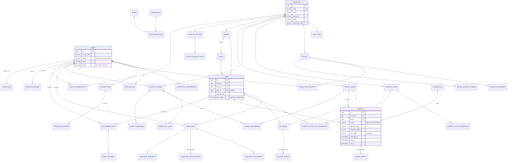

# Database

PostgreSQL (17 in development and tests; 13+ supported). The schema is owned by Flyway
(`src/main/resources/db/migration`); Hibernate only validates it (`ddl-auto=validate`).

| Migration | Contents |
| --- | --- |
| `V1__identity_and_access` | roles, permissions, role_permissions, users, user_roles, refresh_sessions, platform_settings, `forbid_row_update()` trigger function |
| `V2__society_structure` | societies, society_settings, society_delivery_rules, society_memberships, society_counters, stored_files, towers, wings, flats, flat_memberships, family_members |
| `V3__guards_and_gates` | society_gates, security_guards, guard_permissions, guard_assignments, guard_duty_logs |
| `V4__visitors_and_deliveries` | visitors, visitor_events, deliveries, delivery_events |
| `V5__domestic_staff` | domestic_staff, domestic_staff_flat_assignments, domestic_staff_attendance |
| `V6__complaints_and_notices` | complaints, complaint_attachments, complaint_comments, complaint_status_history, notices, notice_audience_towers, notice_attachments, notice_read_receipts |
| `V7__notifications_and_audit` | notifications, notification_outbox, user_devices, notification_preferences, audit_logs |
| `V8__seed_roles_and_permissions` | role and permission reference data, default platform settings |
| `V9__vehicles_and_parking` | society_parking_settings, vehicles, parking_areas, parking_slots, parking_rate_plans, parking_requests, parking_allocations, parking_permits, parking_verifications, parking_sessions, parking_movements, parking_quotes, parking_payments, parking_payment_events, parking_receipts; parking permissions; `VEHICLE_ENTRY` guard toggle. Design, ER diagram and migration notes: [PARKING_DATABASE_DESIGN.md](PARKING_DATABASE_DESIGN.md) |

New changes always go into a new `V10__...` file; applied migrations are never edited.

## Entity relationship diagram

## Design decisions

| Starting-point table (prompt) | Decision |
| --- | --- |
| `visitors`, `visitor_requests`, `visitor_invitations`, `visitor_movements` | Consolidated into **`visitors`** (one row = one visit; `source` = walk-in or invitation, separate `approval_status` and `movement_status` columns) plus the append-only **`visitor_events`**. An invitation is single-use, so it is the visit row itself. |
| `floors` | Modelled as `flats.floor_number`: floors carry no data of their own in Phase 1. |
| `security_guards` + `guard_assignments` | Kept; per-guard gate permissions in `guard_permissions`; on-duty periods in `guard_duty_logs`. |
| `user_roles` vs society roles | `user_roles` holds **platform** roles only (SUPER_ADMIN). Society roles live in `society_memberships`, with detail rows in `flat_memberships` (residents) and `security_guards`. |
| Extra tables | `society_settings`, `society_delivery_rules` (configurable rules), `society_counters` (ticket numbers), `stored_files`, `delivery_events`, `notification_outbox`, `notification_preferences`, `notice_audience_towers`, `complaint_attachments`, `platform_settings`. |

## Integrity rules enforced by the database

* UUID primary keys (generated by the application).
* **Tenant-consistent foreign keys**: e.g. `visitors (flat_id, society_id) → flats (id, society_id)`,
  `visitors (gate_id, society_id) → society_gates (id, society_id)`, `flats (tower_id, society_id) → towers (id, society_id)`,
  `flats (wing_id, tower_id) → wings (id, tower_id)`. A record can never point to a flat or gate of another society.
* Unique: society code; tower code per society; flat number per tower (or wing, `COALESCE` expression index);
  gate name per society; staff mobile and pass number per society; complaint ticket per society; device token;
  user `(country_code, mobile)`; one guard profile per (society, user); one membership per (society, user, role).
* **Partial unique indexes as business rules**: one open flat membership per (flat, user); one active assignment per
  guard; one open duty period per guard; **one open attendance (check-in without check-out) per staff member**;
  one usable invitation per pass code per society.
* CHECK constraints: status enums, invitation must have a pass code and a valid window, a visitor can only be
  inside/exited when approved and with entry time, exit ≥ entry, counts within limits.
* `@Version` optimistic locking on mutable aggregates, plus row locks for state transitions.
* `BEFORE UPDATE` triggers make `visitor_events`, `delivery_events`, `complaint_status_history` and `audit_logs`
  append-only.
* Timestamps are `timestamptz` (UTC); "today" is computed in the society's `time_zone`.

## Soft deletion

Used only for **notices** (`deleted_at`): notifications and audit entries keep pointing at them. Everything else uses
statuses (`ACTIVE/INACTIVE`, membership `ENDED`) so that history stays queryable.

## Personal data and retention

| Data | Who can read it | Retention |
| --- | --- | --- |
| Visitor name, mobile, vehicle, photo | Residents of the visited flat, guards and admins of the society | Removed after `society_settings.visitor_retention_days` (default 365); the visit row and its history remain without personal data (`anonymized_at` set) |
| Delivery agent name / mobile | Same as visitors | Same retention |
| Notifications | The recipient | Deleted after 180 days |
| Refresh sessions | Nobody (hashes only) | Deleted 7 days after expiry |
| Invitation pass codes | Flat residents and admins; guards see `******` except when verifying | Unusable after the window; removed with retention |
| Audit log | Society admins (own society), super admins | Kept (no automatic deletion) |
